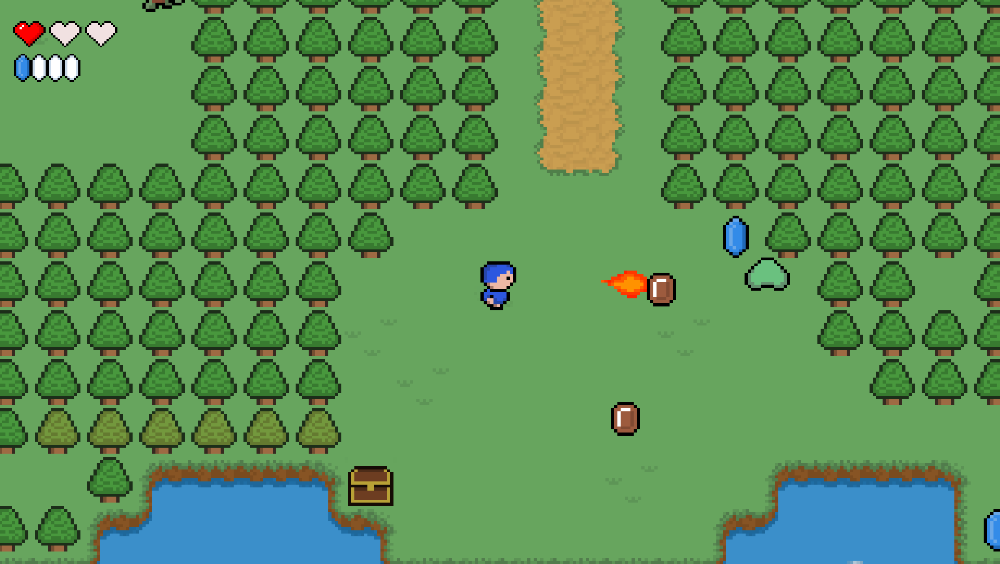
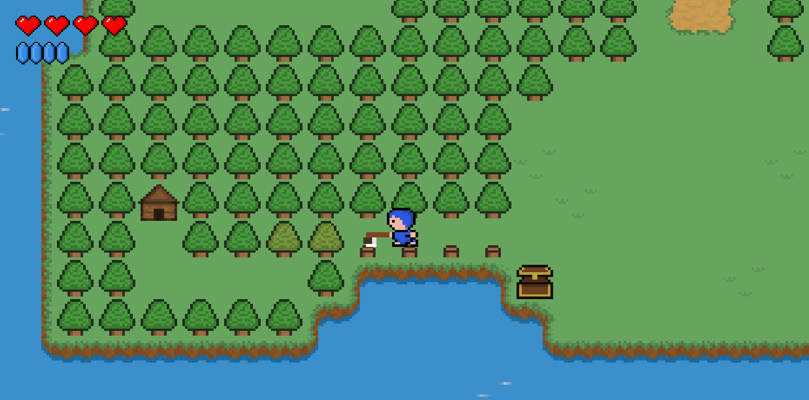
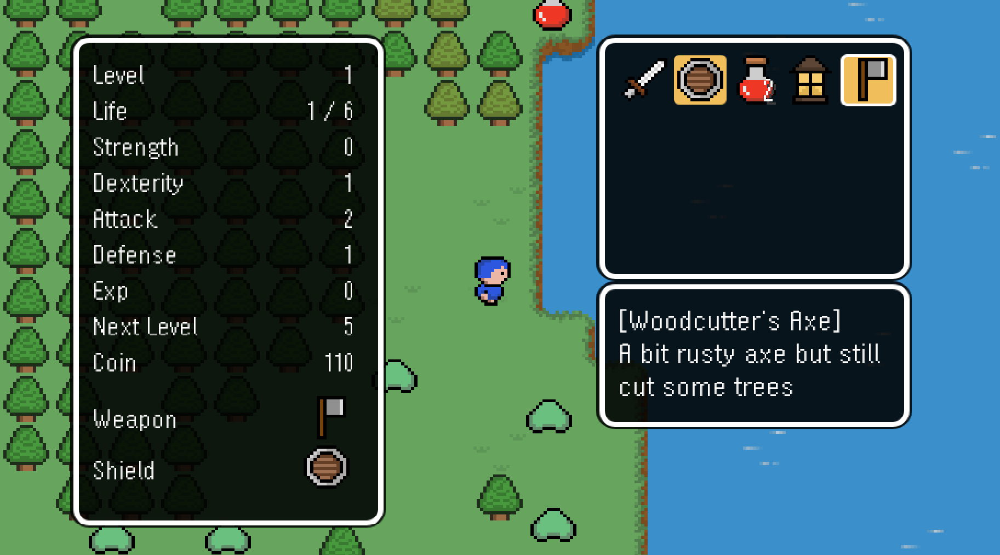
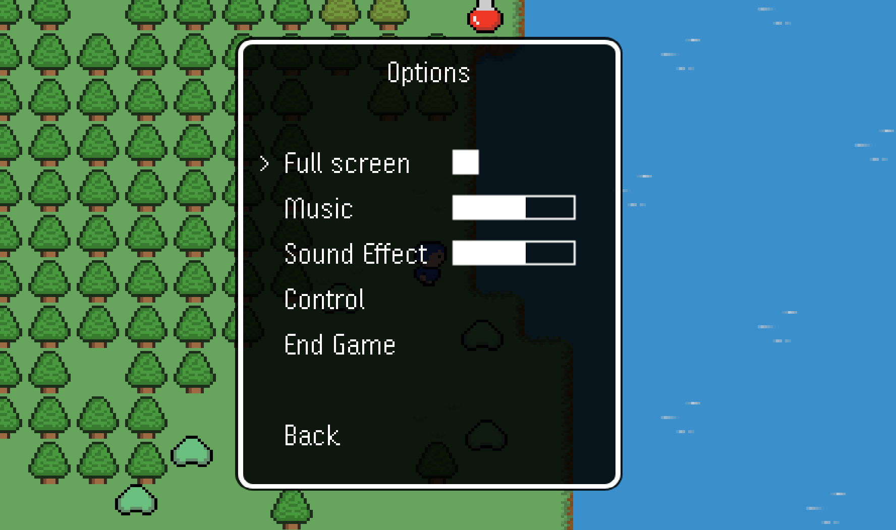
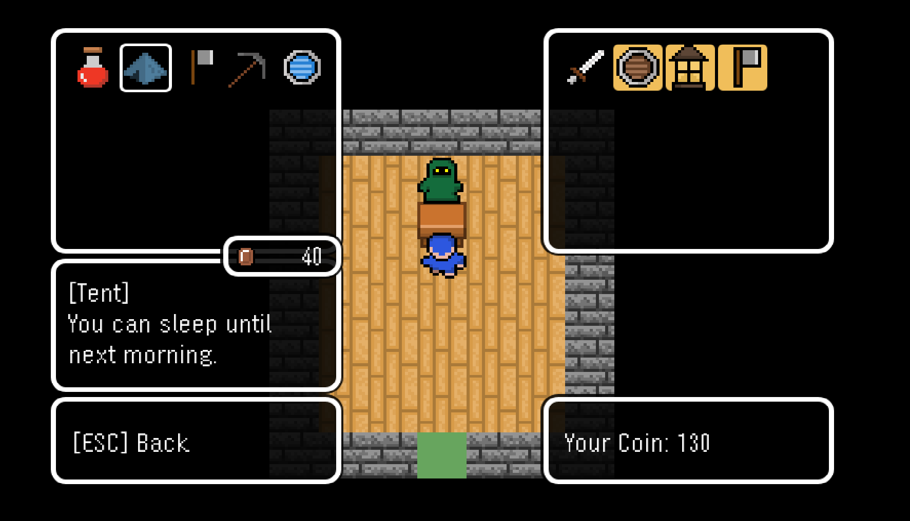
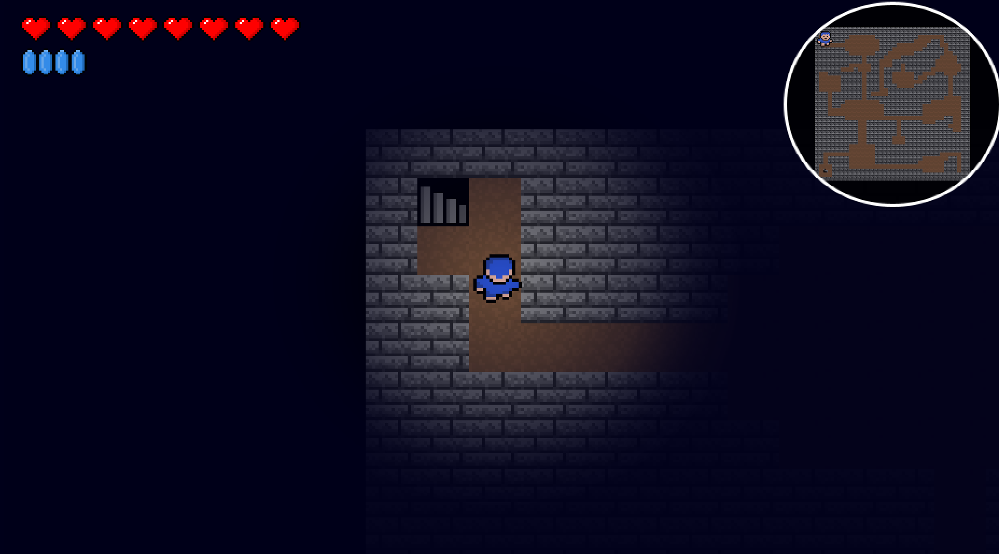
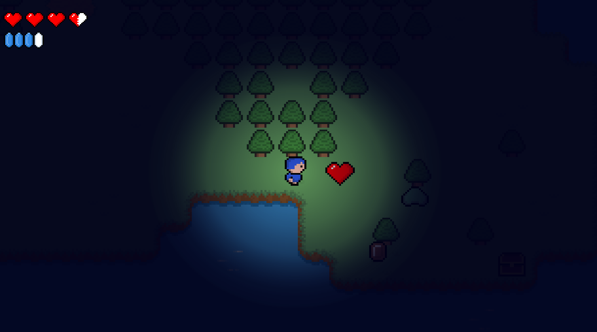
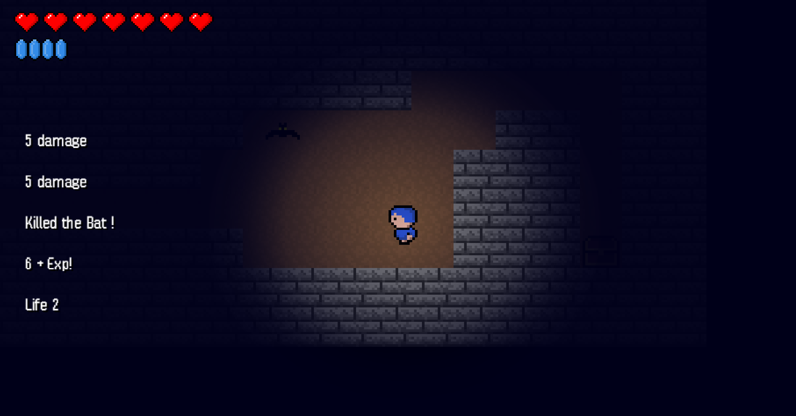
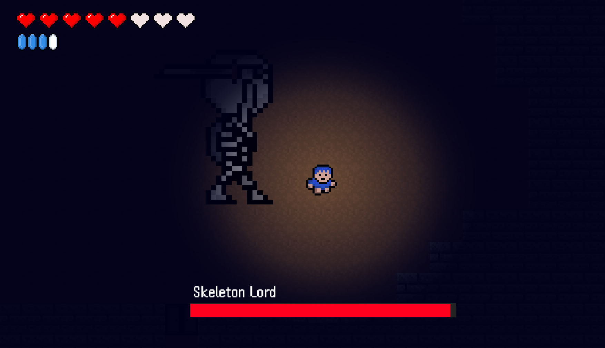

# Blue Boy


### Introduce
A simple 2D game written in Java. :video_game:

### Build

Install JDK 25 and configure your IDE's Gradle JVM to use it.
Build and run the tests using the Gradle wrapper:

```sh
./gradlew build
```

### Saved games

The game stores a versioned JSON save at `~/.blue-boy/save.json`. Saving writes
to a temporary file in the same directory and atomically replaces the previous
save. On first load, if no JSON save exists, the game attempts to import the
old `save.dat` from the process working directory and keeps the original file.
Legacy saves did not record the current map, player position, boss/event flags,
or collected authored drops, so those values cannot be recovered during import.
If an old serialized save is incompatible with the current `DataStorage` class,
loading fails and the original file remains untouched.
Regular monsters and NPCs, including movable rocks, respawn at their starting
positions on load; temporary boss-battle doors are not saved and an unfinished
boss encounter restarts.

The game features such things as:
1) Character system: :runner:
    - character lvl and stats
    - life and mana
    - equipment and items
    - saving and loading progress
2) Interaction with the environment: :deciduous_tree:
    - talking to NPCs
    - destroying and moving objects
    - collecting items from chests
    - logic puzzles
    - interactive fields
3) Enemy and combat system: :hocho:
    - melee attack
    - blocking projectiles and attacks
    - parrying attacks
    - ranged attacks such as fireballs
    - boss battles
    - various types of enemies
    - main character pursuit system
    - mob drops
4) Shop system: :moneybag:
    - buy items
    - sell items
5) Day and night system :sunrise:
6) Different maps and minimap :earth_asia:
7) Sound effects and music :sound:
8) Main and in game menu with settings :wrench:

   


***










