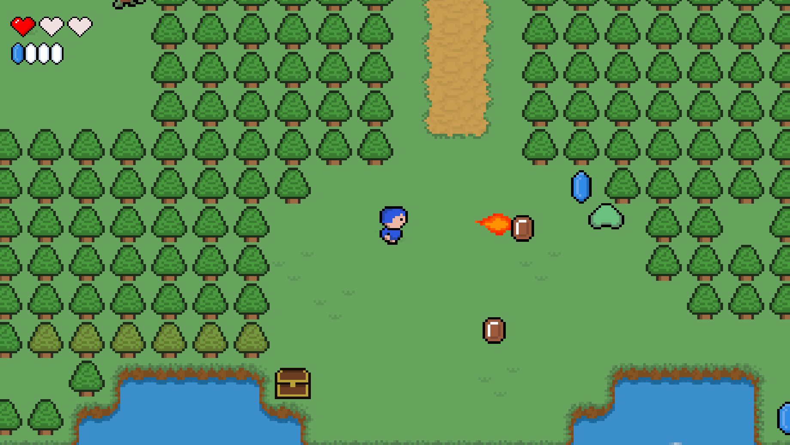
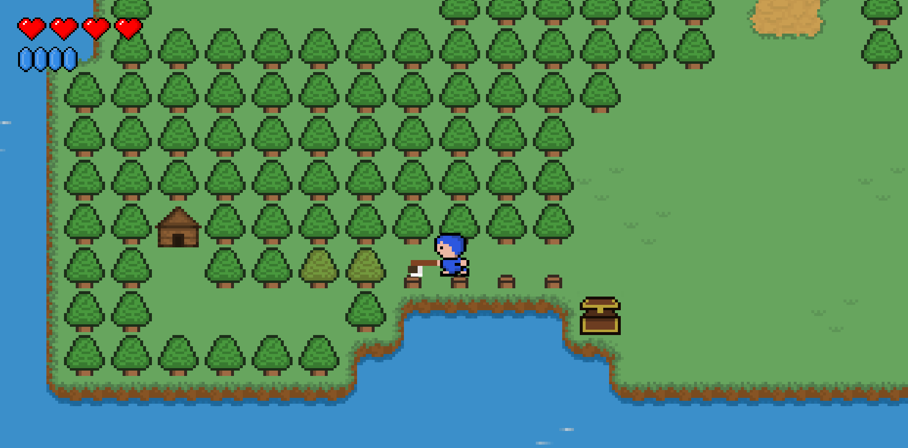
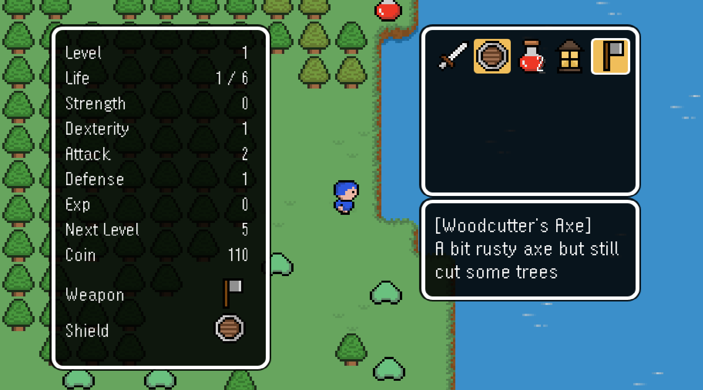
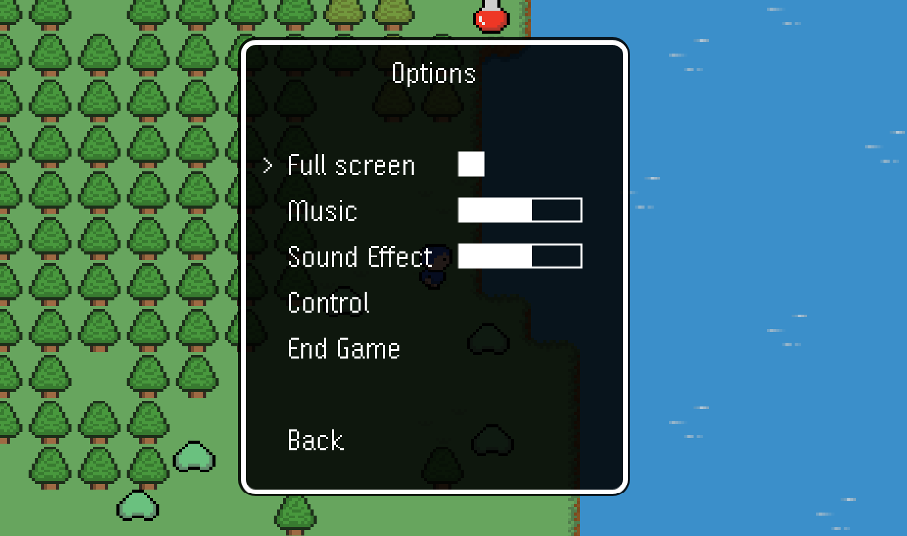
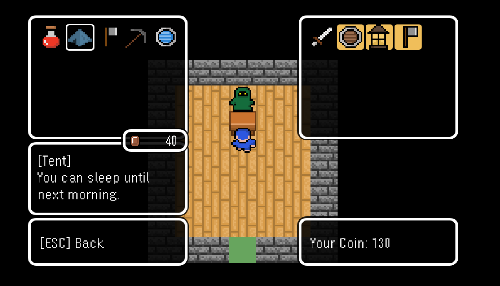
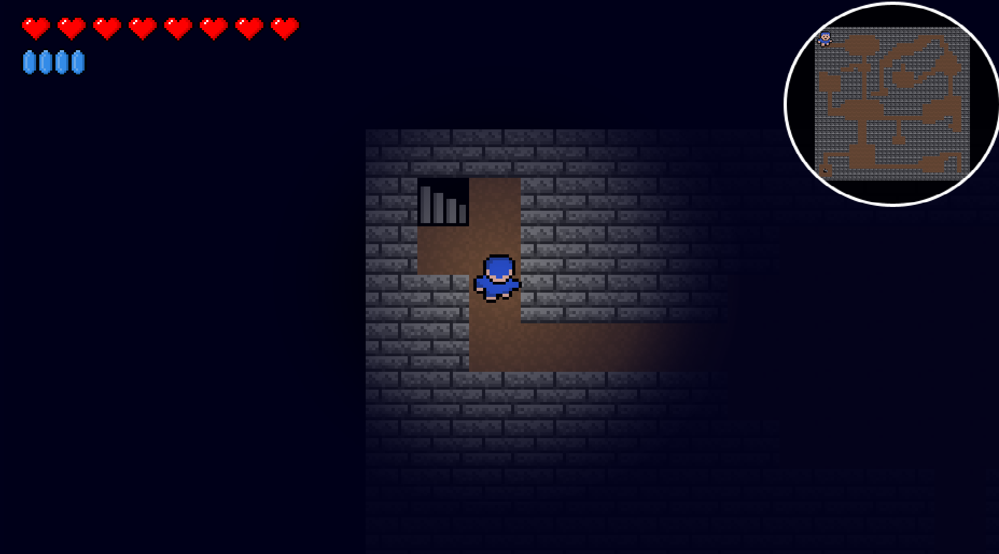
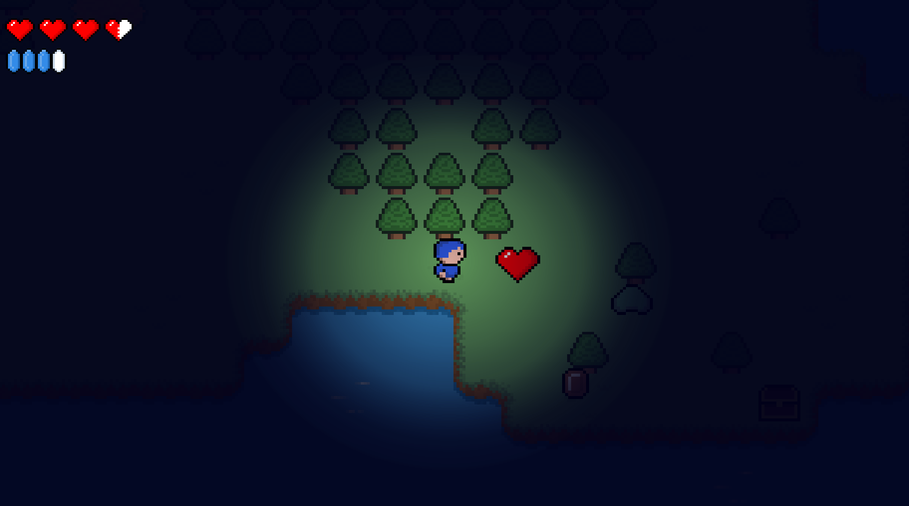
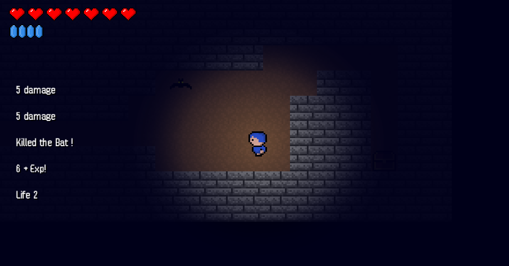
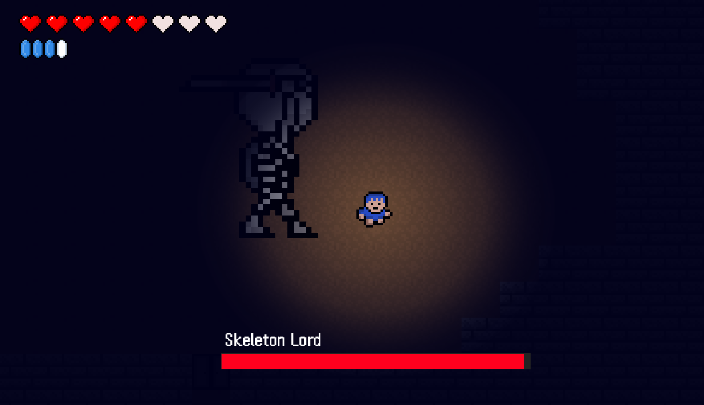

# Blue Boy

### Introduce
A simple 2D game written in Java. :video_game:

The game features such things as:
1) Character system: :runner:
    - character lvl and stats
    - life and mana
    - equipment and items
    - saving and loading progress
2) Interaction with the environment: :deciduous_tree:
    - talking to NPCs
    - destroying and moving objects
    - collecting items from chests
    - logic puzzles
    - interactive fields
3) Enemy and combat system: :hocho:
    - melee attack
    - blocking projectiles and attacks
    - parrying attacks
    - ranged attacks such as fireballs
    - boss battles
    - various types of enemies
    - main character pursuit system
    - mob drops
4) Shop system: :moneybag:
    - buy items
    - sell items
5) Day and night system :sunrise:
6) Different maps and minimap :earth_asia:
7) Sound effects and music :sound:
8) Main and in game menu with settings :wrench:

   

***

